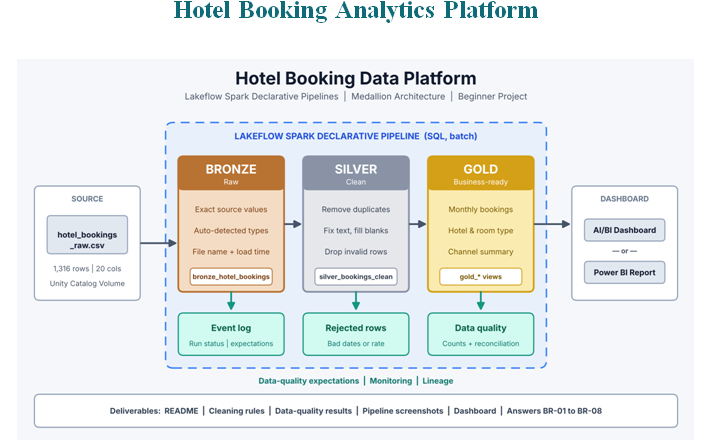
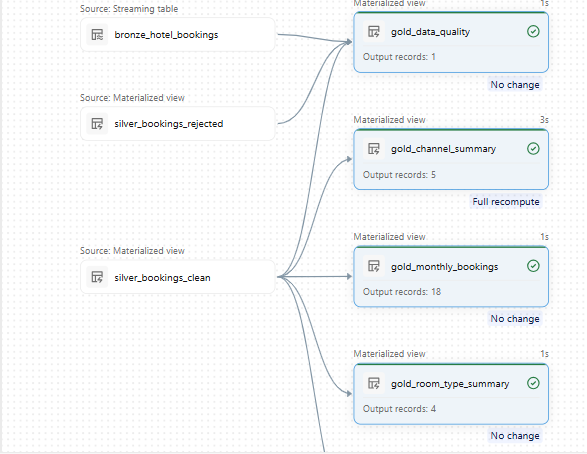

# Hotel Booking Analytics Platform: Medallion Architecture with Lakeflow Spark Declarative Pipelines
An end-to-end hotel booking ETL pipeline on Azure Databricks, built with Lakeflow Spark Declarative Pipelines (SQL) and the Medallion Architecture (Bronze → Silver → Gold). It turns a raw, messy hotel booking CSV into trusted, business-ready reporting tables, with data-quality tracking and reconciliation across layers.
## Architecture

## Table of Contents
1. [Business Problem](#business-problem)
2. [Architecture](#architecture)
3. [Pipeline Lineage](#pipeline-lineage)
4. [Tech Stack](#tech-stack)
5. [Dataset](#dataset)
6. [Repository Structure](#repository-structure)
7. [Layer Details](#layer-details)
8. [Data Quality Rules](#data-quality-rules)
9. [Reconciliation](#reconciliation)
10. [How to Run](#how-to-run)
11. [Business Requirements Coverage](#business-requirements-coverage)
12. [Key Learnings](#key-learnings)
13. [Future Improvements](#future-improvements)
## Business Problem
The hotel group has no automatic way to turn the raw bookings file into numbers it can trust. This project builds a repeatable pipeline that keeps the original file, cleans the data, prepares summary tables and shows them in a dashboard.
### Goal: build a repeatable, managed pipeline that preserves the raw data, standardizes and validates records, and publishes trusted Gold tables for booking and revenue analysis.

## Architecture
sales.csv (Unity Catalog Volume) → Bronze (raw, traceable) → Silver (cleaned, validated) → Gold (business aggregates) → Databricks SQL / dashboards / BI tools

| Layer	| Purpose	| Key actions|
|-------|---------|-------------|
|Bronze	| Preserve source data|	Load CSV, keep original values, add ingestion metadata|
|Silver	| Improve trust and consistency	| Trim text, standardize categories, cast types, flag invalid values, handle duplicates|
|Gold	| Serve business questions	| Monthly trends, hotel, room type, channel, data-quality summary|
## Pipeline Lineage


|Object	| Type	| Description|
|-------|--------|------------|
|bronze_hotel_booking|	Streaming table|	Raw ingested sales records|
|silver_clean	|Materialized view|	Cleaned and validated records|
|gold_monthly_booking	|Materialized view|	bookings, revenue by month|
|gold_hotel_summary|	Materialized view|	booking, room_nights, avg_daily_rate, by region, city, hotel name|
|gold_room_type_summary|	Materialized view|	bookings, net revenue by room type|
|gold_channel_summary|	Materialized view|	bookings, net revenue by booking channels
|gold_data_quality_summary	|Materialized view|	Issue counts and validation status (reads Bronze and Silver)
### Materialized views refresh incrementally where possible.

## Tech Stack
1. Azure Databricks
2. Lakeflow Spark Declarative Pipelines (SQL)
3. Unity Catalog (Volumes)
4. Delta Lake
5. Databricks SQL
## Dataset
Dataset hotel_bookings_raw.csv is synthetic (made up for this project). It has 1,316 rows and 20 columns covering hotel stays in 2025.

The grain is one booking line per row.**booking ID** alone is unique for each real booking.

## Repository Structure
```text
Hotel_Booking_Medallion_Lakeflow/
|
├── README.md
├── data/
     |_ hotel_bookings_raw.csv                     # sample dataset
├── ETL pipeline/
│   ├── bronze/bronze_transformation.sql
│   ├── silver/silver_transformation.sql
│   └── gold/gold_transformation.sql
├── docs/                      # case study
└── images/                    # architecture and screenshots
``` 

## Layer Details
### Bronze
- Reads the CSV from a Unity Catalog Volume: TODO: /Volumes/<catalog>/<schema>/<volume>/hotel_booking.csv
- Keeps source values unchanged
- Adds ingestion metadata: TODO: e.g. _ingest_timestamp, _source_file
### Silver
- TODO: Remove spaces, use Title Case
- TODO: quality flags and duplicate handling
- TODO: pipeline expectations (CONSTRAINT ... EXPECT ...)
### Gold
- gold_monthly_booking: bookings, revenue by month
- gold_hotel_summary: region, city, hotel name comparision
- gold_room_type_summary: room type comparision
- gold_data_quality_summary: missing, invalid, duplicate and suspicious counts
## Data Quality Rules
|Rule	|Treatment|
|-----|----------|
|Remove duplicates|SELECT DISTINCT|
|Fix text|TRIM+INITCAP|
|Fill blanks|COALESCE+ DATEDIFF|
|Check rules | EXCEPT  DROP ROW|

## Reconciliation
|Check|	Result|
|------|------|
|Source CSV rows|	1,506|
|Bronze rows|	TODO|
|Silver clean rows|	TODO|
|Silver reject rows|	TODO (reason: TODO)|
|Clean rows Gold data quality = total bookings|	TODO

## How to Run
1. Upload sales.csv to a Unity Catalog Volume and confirm read permissions.
2. Clone this repo into your Databricks workspace (Repos / Git folder).
3. Create a new Lakeflow Spark Declarative Pipeline and add the SQL files under pipeline/ as source code.
4. Set the target catalog and schema: TODO.
5. Run the pipeline (Start or Full refresh).
6. Run the checks in validation/ and query the Gold tables.
## Business Requirements Coverage
|ID|Requirement|Business expectation|
|--|-----------|--------------------|
BR-01
Monthly trends
Show bookings, cancelled bookings, room nights and net revenue for each stay month.
BR-02
Hotel performance
Compare bookings, room nights, net revenue and average daily rate by region, city and hotel.
BR-03
Room type performance
Compare bookings, room nights, net revenue and average guest rating by room type.
BR-04
Channel analysis
Compare bookings, cancelled bookings, cancellation rate and net revenue by booking channel.
BR-05
Data-quality visibility
Show how many rows had each problem (duplicates, bad dates, bad rate, blanks).
BR-06
Reconciliation
Prove that Bronze rows = clean rows + rejected rows + duplicates removed.
BR-07
Repeatability
Run everything as a Databricks pipeline that can be re-run with one click.
BR-08
Dashboard
Build one dashboard (Databricks AI/BI or Power BI) on the Gold tables.


## Key Learnings
Why raw data is preserved in Bronze for traceability
Flagging vs. rejecting records
Why Order ID is an unsafe duplicate key
Declarative pipelines with data-quality expectations and lineage
## Future Improvements
Daily file arrival with Auto Loader and incremental processing
Separate customer and product dimension tables
Alerts and monitoring on data-quality metrics
Dashboard on top of the Gold layer
## License
MIT (see LICENSE)


