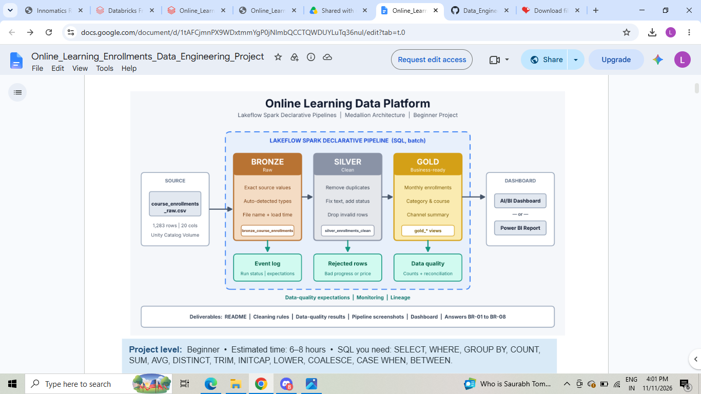

# Lakeflow Spark Declarative Pipelines
# Online Learning Enrollment Analytics Platform
An end-to-end online learning enrollment ETL pipeline on **Azure Databricks**, built with **Lakeflow Spark Declarative Pipelines (SQL)** and the **Medallion Architecture (Bronze → Silver → Gold)**. It turns a raw, messy online learning CSV into trusted, business-ready reporting tables, with data-quality tracking and reconciliation across layers.
## Project Architecture

## Project Overview
- This pipeline processes the raw online enrollments data, perform data cleaning and validation, separates valid and rejected records, and generates business-level summary tables for analysis.
- The project follows **Medallion Architecture (Bronze, Silver, and Gold layers)** to organize data processing and improve data quality.
## 🎯 Project Objectives

- Build an end-to-end ETL pipeline using Databricks.
- Ingest raw booking data into the Bronze layer.
- Clean and transform data in the Silver layer.
- Separate valid and invalid records.
- Generate aggregated business insights in the Gold layer.
- Automate pipeline execution using Databricks Workflows.
- Build interactive dashboards using AI/BI Databricks.

---

## 🛠️ Technologies Used

| Technology | Purpose |
|---|---|
| Databricks | Data Engineering Platform |
| Apache Spark | Distributed Data Processing |
| PySpark | Data Transformation |
| SQL | Data Analysis and Aggregation |
| Delta Lake | Data Storage |
| Unity Catalog | Data Governance |
## 🏗️ Architecture – Medallion Architecture

The project follows a three-layer architecture.

### 1. Bronze Layer – Raw Data

- Ingest raw booking data.
- Store the original records.
- Maintain the source data for further processing.

### 2. Silver Layer – Cleaned Data

- Handle missing values.
- Remove duplicate records.
- Validate booking records.
- Apply data quality rules.
- Separate records into:
  - `silver_clean` – Valid records.
  - `silver_rejected` – Invalid records.

### 3. Gold Layer – Business-Level Data

- Perform aggregations.
- Calculate enrollments metrics.
- Generate course-wise summary, category-wise summary, channel-wise summary.
- Analyze completed, in-progress, not completed course trends.
- calculate the revenue. 
- Prepare data for dashboard development.

---

## 🔄 ETL Workflow

1. Extract raw booking data.
2. Load data into the Bronze layer.
3. Transform and clean the data.
4. Validate records using business rules.
5. Store valid and rejected records in separate Silver tables.
6. Perform aggregations in the Gold layer.
7. Generate analytical summaries.
8. Execute the pipeline using Databricks Workflows.

---

## 📂 Project Structure

```text
Online_Learning_Enrollment_Projec/
|
├── README.md
├── data/
     |_ Online_learning_raw.csv                     # sample dataset
├── ETL pipeline/
│   ├── Online_bronze/bronze_transformation.sql
│   ├── Online_silver/silver_transformation.sql
│   └── Online_gold/gold_transformation.sql
├── docs/                      # case study
└── images/                    # architecture and pipeline_lineage
---
```
## 📊 Key Analysis

The Gold layer focuses on generating business insights such as:

- Total enrollments.
- Net_Revenue.
- Completion rate.
- Channel-wise summary.
- Course-wise summary.
- Category-wise summary.
- learner_status trends and patterns.

---

## ⚙️ Pipeline Execution

1. Open the Databricks workspace.
2. Configure the required catalog and schema.
3. Upload or access the source dataset.
4. Execute the Bronze ingestion notebook.
5. Run the Silver transformation notebook.
6. Execute the Gold aggregation notebook.
7. Validate the output tables.
8. Run the complete workflow through Databricks Jobs.

---

## 📈 Data Quality

Data quality is maintained through:

- Duplicate record checks.
- Null value validation.
- Required column validation.
- Business rule validation.
- Rejected record identification.
- Clean and rejected record separation.

---

## 💡 Key Learnings

Through this project, I gained practical experience in:

- Building ETL pipelines.
- Understanding Medallion Architecture.
- Working with Databricks and PySpark.
- Implementing data cleaning and validation.
- Creating Delta tables.
- Performing SQL aggregations.
- Managing data using Unity Catalog.
- Executing workflows in Databricks.

---

## 🔮 Future Enhancements

- Implement incremental data loading.
- Add automated data quality monitoring.
- Implement pipeline failure notifications.
- Integrate Power BI for visualization.
- Optimize pipeline performance.

---

## 👩‍💻 Author

**Swetha**

Aspiring Data Analyst | Data Engineering Enthusiast

---

⭐ If you find this project useful, feel free to explore the repository!
